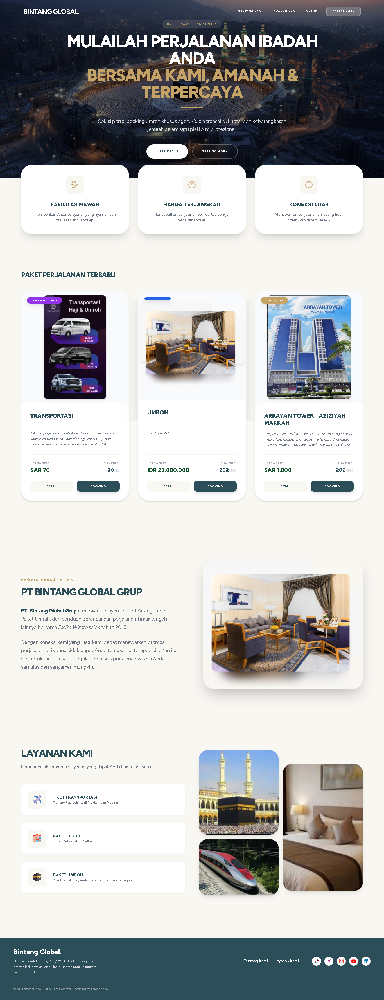

# 🌍 Travel Bintangglobal (Website Biro Perjalanan)

> Platform website travel dan biro perjalanan berbasis **Laravel** dan **MySQL** yang dirancang untuk memudahkan pengguna dalam melihat informasi paket wisata, pemesanan, dan pengelolaan data perjalanan secara online.

---

## 🛠️ Tech Stack (Teknologi yang Digunakan)
* **Backend:** PHP, Laravel
* **Database:** MySQL
* **Frontend:** Blade Templating, Tailwind CSS / Bootstrap
* **Version Control:** Git & GitHub

---

## 🌟 Fitur Utama
1. **Katalog Paket Wisata:** Menampilkan daftar destinasi dan paket perjalanan lengkap dengan deskripsi serta harga.
2. **Sistem Pemesanan (Booking):** Memungkinkan pengguna untuk melakukan pemesanan tiket atau paket travel.
3. **Manajemen Admin (CRUD):** Panel khusus untuk mengelola data paket wisata, transaksi, dan data pelanggan.

---

## 📸 Tampilan Antarmuka (Screenshots)


---

## ⚙️ Cara Menjalankan Proyek (Installation)
Bagi yang ingin menjalankan kode ini secara lokal di komputer:

1. Clone repository ini:
   ```bash
   git clone [https://github.com/rifqiilyasa300-oss/travel-bintangglobal.git](https://github.com/rifqiilyasa300-oss/travel-bintangglobal.git)
